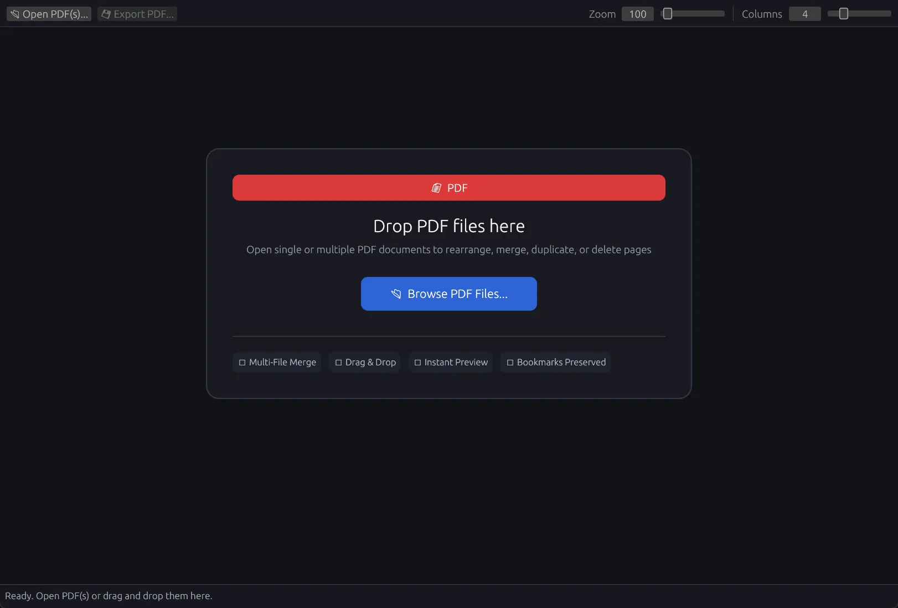
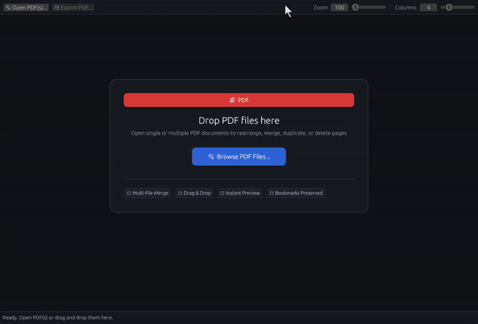

# pdf-arranger-clone

Clone of [pdf-arranger](https://github.com/pdfarranger/pdfarranger) - Small python-gtk application, which helps the user to merge or split PDF documents and rotate, crop and rearrange their pages using an interactive and intuitive graphical interface.

This tool is rust-based using Egui & [PDFium](https://github.com/bblanchon/pdfium-binaries)


## Project Ideation and TODOs
### Rendering flow

```text
PDF file
   ↓
PDFium / MuPDF / Poppler
   ↓
RGBA bitmap
   ↓
thumbnail cache
   ↓
GUI texture
```

### Export flow

```text
Project.pages
   ↓
Load source PDF pages
   ↓
Copy pages in project order
   ↓
Apply page rotation
   ↓
Write output PDF
```

Do not export through PNG files. That would remove selectable text, vector graphics, links, annotations, and document metadata.

## Suggested `Cargo.toml`

A practical first version using `egui`, PDFium, and `lopdf`:

```toml
[package]
name = "pdf-arranger"
version = "0.1.0"
edition = "2021"

[dependencies]
anyhow = "1"
thiserror = "2"

# GUI
eframe = "0.33"
egui = "0.33"

# PDF rendering and thumbnails
pdfium-render = "0.9"

# Image conversion and thumbnail encoding
image = "0.25"

# PDF structure manipulation
lopdf = "0.36"

# IDs for pages and documents
uuid = { version = "1", features = ["v4"] }

# File dialogs
rfd = "0.15"

# Optional: background jobs and channels
crossbeam-channel = "0.5"

[profile.release]
opt-level = 3
lto = true
codegen-units = 1
```

`pdfium-render` provides high-quality page rendering, while `lopdf` works with PDF objects and document structure. They serve different purposes and are useful together. <citation src="1,3"></citation>

## Suggested module layout

```text
src/
├── main.rs
├── app.rs                 # GUI application state
├── model/
│   ├── mod.rs
│   ├── project.rs         # Project and PageItem
│   └── commands.rs        # Move, delete, rotate, duplicate
├── pdf/
│   ├── mod.rs
│   ├── renderer.rs        # PDF → thumbnail
│   ├── exporter.rs        # Project → output PDF
│   └── cache.rs           # Thumbnail cache
├── ui/
│   ├── toolbar.rs
│   ├── thumbnail_grid.rs
│   └── dialogs.rs
└── history.rs             # Undo/redo
```

## PDF tool comparison

| Tool | Rust interface | Rendering | Page manipulation | Native dependency | Recommended use |
|---|---|---:|---:|---:|---|
| `pdfium-render` | High-level Rust wrapper | Excellent | Some | PDFium | Thumbnails, previews, viewers |
| `pdfium` | Lower-level PDFium binding | Excellent | Some | PDFium | Direct PDFium integration |
| MuPDF bindings | Rust bindings | Excellent | Good | MuPDF | Fast rendering and compact viewers |
| Poppler | Usually via FFI or CLI | Excellent | Limited | Poppler | Linux-oriented applications |
| `lopdf` | Pure Rust | No renderer | Good | None | PDF objects, splitting, metadata |
| `pdf-writer` | Pure Rust | No | Creates PDFs | None | Generating new PDFs |
| `printpdf` | Pure Rust | No | Creates PDFs | None | Simple PDF generation |
| `pdf-extract` | Pure Rust | No | No | None | Text extraction |
| `pdf2image`/CLI tools | External process | Good | Limited | External tools | Quick prototypes |

### `pdfium-render`

Best default for your application.

Advantages:

- Good rendering quality.
- Handles complicated PDFs better than a hand-written parser.
- Suitable for thumbnails and page previews.
- Good fit for zooming and PDF viewer features.

Disadvantage:

- Requires a compatible PDFium shared library or bundled binary.

### Development Milestones
* **Milestone 1:** Open single and multiple PDF files using native dialogs and drag-and-drop. *(Achieved)*
* **Milestone 2:** Non-blocking page preview and thumbnail rendering via background worker (`pdfium-render` + `crossbeam-channel`). *(Achieved)*
* **Milestone 3:** Interactive UI grid with single/multi/range selection, dynamic zooming, and responsive layouts. *(Achieved)*
* **Milestone 4:** Document model manipulation: reordering, deletion, and duplication. *(Achieved)*
* **Milestone 5:** Vector/object PDF export with resource deduplication, compression, and bookmark (`/Outlines`) preservation. *(Achieved)*
* **Milestone 6:** Page rotation (90° / 180° / 270°) with live thumbnail updates and export `/Rotate` tags. *(Roadmap)*
* **Milestone 7:** Undo / Redo command history stack (`Ctrl+Z`, `Ctrl+Y`). *(Roadmap)*
* **Milestone 8:** Direct drag-and-drop card reordering in the grid. *(Roadmap)*

---

## Issues Identified & Solutions Implemented

### 1. Export File Size Bloat (Duplicate Shared Resources)
* **Problem**: Opening a PDF (e.g. 3 MB) and exporting it with zero modifications produced an output file significantly larger than the original.
* **Root Cause**: The visited object tracking map in `src/pdf/exporter.rs` was instantiated inside the loop for each page. Shared indirect objects (embedded TrueType/OpenType/CFF font streams, header logos, images/XObjects, color profiles) were duplicated *N* times across *N* pages. Additionally, stream compression (`compress()`) and orphaned object pruning were omitted.
* **Solution**:
  - Implemented persistent per-document object deduplication (`visited_per_doc: Vec<HashMap<ObjectId, ObjectId>>`) in [`src/pdf/exporter.rs`](file:///d:/Work/Repos/my_repo/pdf-arranger-clone/src/pdf/exporter.rs).
  - Every project page receives its own independent page dictionary in the destination document (preserving page hierarchy validity), while all referenced fonts, images, and streams are shared and copied only once.
  - Added [`dest_doc.prune_objects()`](file:///d:/Work/Repos/my_repo/pdf-arranger-clone/src/pdf/exporter.rs) and [`dest_doc.compress()`](file:///d:/Work/Repos/my_repo/pdf-arranger-clone/src/pdf/exporter.rs).

### 2. Missing Table of Contents / Bookmarks (`/Outlines`)
* **Problem**: Original PDF bookmarks, navigation outlines, and tables of contents were discarded on export.
* **Solution**:
  - Implemented recursive outline tree extraction from each source document Catalog.
  - Handled explicit destinations (`/Dest [page /XYZ ...]`), GoTo actions (`/A << /S /GoTo /D ... >>`), and named destinations (resolved via `/Catalog /Dests` and `/Names -> /Dests` name trees).
  - Remapped all bookmark target destinations to their new page locations in the arranged project.
  - Pruned bookmarks pointing to deleted pages that have no surviving child items.
  - Added `/PageMode /UseOutlines` to the output Catalog so PDF viewers automatically open with the bookmarks sidebar visible.

### 3. UI Freezes & Main-Thread Thumbnail Lag
* **Problem**: Thumbnail generation executed synchronously during the egui frame draw, causing UI lag, frame drops, and freezes when loading documents with many pages.
* **Solution**:
  - Implemented [`ThumbnailWorker`](file:///d:/Work/Repos/my_repo/pdf-arranger-clone/src/pdf/renderer.rs) running on a dedicated background worker thread using `crossbeam-channel`.
  - The worker processes pages asynchronously and calls `ctx.request_repaint()` to trigger reactive UI repaints the moment an image is ready.
  - Added skeleton placeholder cards while thumbnails load in the background, paired with a status bar spinner and pending counter.

### 4. Single-File Ingestion Limitation
* **Problem**: Only one PDF file could be loaded at a time; drag-and-drop only grabbed the first dropped file.
* **Solution**:
  - Replaced `rfd::FileDialog::pick_file()` with `rfd::FileDialog::pick_files()` in the toolbar.
  - Updated the drag-and-drop listener to filter and batch-load all dropped `.pdf` files.
  - Implemented `load_pdf_files()` to append multiple documents into the project model.

### 5. Toolbar Overlap & Pitch-Black Empty Screen
* **Problem**: Default window opening size (~800x600) was too small, causing sliders and action buttons to collide. The initial screen was a pitch-black void with plain single-line text.
* **Solution**:
  - Configured native window viewport in [`src/main.rs`](file:///d:/Work/Repos/my_repo/pdf-arranger-clone/src/main.rs) with initial size `1120 x 760` (min `720 x 500`).
  - Constrained slider widths (`slider_width = 80.0`) and simplified labels to prevent collisions.
  - Designed an interactive dropzone card in [`src/ui/thumbnail_grid.rs`](file:///d:/Work/Repos/my_repo/pdf-arranger-clone/src/ui/thumbnail_grid.rs) with a red PDF icon badge, drag-over hover blue glow (`#4285f4`), primary browse button, and feature badges.

### 6. Ambiguous Multi-PDF Thumbnail Identification
* **Problem**: When multiple documents were opened, every thumbnail showed `Page X`, making it unclear which source document a page originated from.
* **Solution**:
  - Formatted thumbnail titles as `number1(Page number2)` (e.g. `1(Page 1)`..`1(Page 10)`, `2(Page 1)`..`2(Page 4)`), where `number1` is the 1-based source PDF file index and `number2` is that document's page number.
  - Added hover tooltips displaying the exact source filename and page index.

---

### Screenshots





